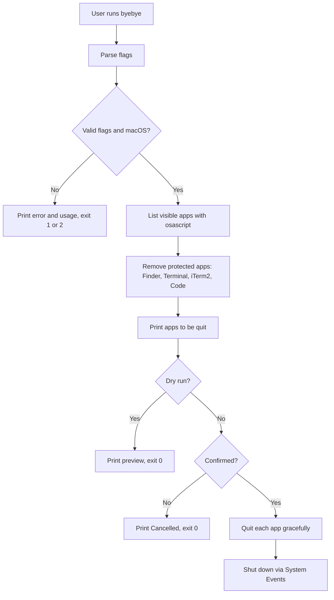

# byebye

> `byebye` quits every open Mac app cleanly and then shuts the computer down, all from one terminal command.

**Team:** Yash Mulik, Divya More
**Repository:** https://github.com/yashmulik3126/byebye
**Date:** 29-10-2026

---

## 1. The problem

### What we keep doing by hand

At the end of a work session, quitting everything and shutting down takes a pile of manual steps:

```bash
# TODO: replace with the exact sequence you really use, for example:
# Cmd+Q on Chrome, VS Code, Notes, Spotify, ... one app at a time
# then Apple menu > Shut Down > confirm
```

### Evidence that this is real

```bash
history | grep -E "shutdown|osascript|killall" | wc -l
```

```
# TODO: paste your real output here
```

TODO: two sentences. How often does this happen (every day?), and what does it cost you each time (about how many seconds or clicks)?

### Who else has this problem

TODO: one or two sentences. Who did you ask, and what did they say?

---

## 2. Prior art: what already exists

### Tools we found and actually tried

| Tool | Where we found it | What it does | Why it does not solve our problem |
|---|---|---|---|
| Apple menu > Shut Down | macOS built in | Quits apps and shuts down | GUI only, needs clicks, cannot be scripted or dry-run |
| `sudo shutdown -h now` | `man shutdown` | Shuts down immediately | Needs sudo, does not quit apps gracefully, and unsaved work can be lost |
| `osascript -e 'tell app "System Events" to shut down'` | Stack Overflow / `man osascript` | Asks macOS to shut down, apps get a chance to quit | One long command to remember, no preview of which apps close, no confirmation |
| `pmset sleepnow` | `man pmset` | Sleeps the Mac | Sleeps rather than shuts down |
| TODO | TODO | TODO | TODO |

> TODO: the rows above are what we expect from documentation. Install or run each one yourself and confirm before submitting.

### Evidence of trying them

```bash
# TODO: what we ran, for example:
osascript -e 'tell app "System Events" to shut down'
```

```
# TODO: what it printed or did
```

TODO: one paragraph. What did this tool get right, and what exactly was missing?

### Where we searched

- [ ] `man -k shutdown`
- [ ] GitHub search
- [ ] Homebrew: `brew search quit` / `brew search shutdown`
- [ ] Stack Overflow
- [ ] npm / PyPI
- [ ] Asked a human: TODO

### The gap, in one sentence

"Existing tools can **quit apps or shut down**, but none of them **gives you one scriptable command that shows which apps will close, asks for confirmation, supports a dry run, and then shuts down**, which is the part that actually costs us time."

> TODO: check this sentence against what you actually find. If one of the tools already does all of this, talk to your instructor before going further.

---

## 3. What we are building

### In scope

- Quit all visible apps gracefully, so apps can still prompt about unsaved work
- Show the list of apps before doing anything
- Ask for confirmation (skippable with `--yes`)
- Provide `--dry-run` to preview safely
- Shut down the Mac when the apps have quit

### Out of scope

- Closing individual browser tabs. Quitting the browser closes all its tabs, and scripting every browser separately is a different project.
- Force-killing apps. Forced quits can lose unsaved work, so we deliberately never do it.
- Windows and Linux support. The tool depends on macOS and AppleScript.
- Scheduled shutdowns. `pmset schedule` already does that.

### How we will know it worked

"This tool is successful if it turns **about 10 manual steps (quit each app, then Apple menu > Shut Down) into 1 command**, and we actually use it after the assignment ends."

---

## 4. Tech stack

| Choice | What we picked | Why, and what we rejected |
|---|---|---|
| Language | Bash | Ships with macOS, no install needed. Rejected Python because it adds a runtime for what is mostly calling system commands. |
| Argument parsing | Plain `case` statement | Only four flags, so `getopt` would be extra complexity. |
| Other dependencies | `osascript` (built in) | The standard way to talk to macOS apps. No extra installs. |
| Testing | Manual tests with `--dry-run`, plus `shellcheck` | TODO: confirm you ran `brew install shellcheck && shellcheck byebye.sh` |
| Packaging / install method | Copy the script into `~/bin` | Rejected a Homebrew formula as too heavy for a single script. |

### Why this language

Bash is already on every Mac, and the tool is mostly one command calling another. Python would work too, but it would add more code and a dependency for no real gain.

### What we are deliberately not using

Pure `sudo shutdown`, because it skips the graceful quit and can lose unsaved work.

---

## 5. Architecture



### Components

| Part | Responsibility | File |
|---|---|---|
| Flag parser | Reads `-h`, `-n`, `-v`, `-y` | `byebye.sh` |
| App collector | Lists visible apps and filters out protected ones | `byebye.sh` |
| Quitter | Sends a graceful quit to each app | `byebye.sh` |
| Shutdown step | Asks macOS to shut down | `byebye.sh` |

### Data flow

The app list comes from macOS itself, via `osascript` asking System Events for every non-background app. The script filters that list, prints it, and sends each remaining app a quit request. Once the apps have had a few seconds to close, it asks macOS to shut down.

### What happens when things go wrong

| If this happens | The tool does this |
|---|---|
| Not running on macOS | Prints an error and exits with code 1 |
| An unknown flag is passed | Prints the error and usage, exits with code 2 |
| Automation permission is missing | Prints how to grant it, exits with code 3 |
| One app refuses to quit | Prints a warning for that app and continues with the rest |
| An app has unsaved work | The app shows its own save dialog and macOS waits instead of forcing it |

---

## 6. Usage

### Synopsis

```
byebye [options]
```

### Commands and flags

| Flag | Long form | What it does | Default |
|---|---|---|---|
| `-h` | `--help` | Show usage and exit | |
| `-n` | `--dry-run` | Show what would happen, change nothing | off |
| `-v` | `--verbose` | More output | off |
| `-y` | `--yes` | Skip the confirmation prompt | off |

### Examples

**Basic use**

```bash
$ byebye
```

```
# TODO: paste real output
```

**With a flag**

```bash
$ byebye --dry-run
```

```
# TODO: paste real output
```

**When it fails**

```bash
$ byebye --nonsense
```

```
# TODO: paste real error message
```

### Exit codes

| Code | Meaning |
|---|---|
| 0 | Success, dry run finished, or the user cancelled |
| 1 | Not running on macOS |
| 2 | Unknown option |
| 3 | Could not list apps (Automation permission missing) |

### Installation

```bash
git clone https://github.com/yashmulik3126/byebye.git
cd byebye
chmod +x byebye.sh
mkdir -p ~/bin
cp byebye.sh ~/bin/byebye
echo 'export PATH="$HOME/bin:$PATH"' >> ~/.zshrc
source ~/.zshrc
```

The first run may trigger a macOS prompt asking Terminal for permission to control System Events. Click **OK**.

---

## 7. References

- [macOS `osascript` man page](https://ss64.com/mac/osascript.html) — how to run AppleScript from the terminal
- [`shutdown` man page](https://ss64.com/mac/shutdown.html) — the existing command we compared against
- [`pmset` man page](https://ss64.com/mac/pmset.html) — sleep and scheduled power events
- TODO: add every other page you actually read, with one line on what you took from it
